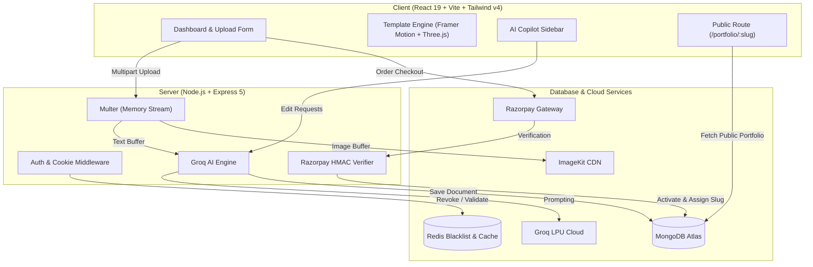

<div align="center">

# ⚡ Flexoraa
### AI-Powered Resume-to-Portfolio Platform

Transform static PDF resumes into interactive, high-performance developer portfolios with real-time AI personalization, interactive 3D elements, and one-click publishing.

🌐 **Live Website:** [https://www.flexoraa.in](https://www.flexoraa.in)  
🟢 **API Health:** [https://flexoraa-1.onrender.com/api/health](https://flexoraa-1.onrender.com/api/health)


```
Upload Resume (PDF)  ➔  Groq AI Parsing  ➔  Interactive 3D Portfolio  ➔  Live AI Copilot  ➔  One-Click Publish
```

</div>

---

## 📖 About Flexoraa

**Flexoraa** is a full-stack AI SaaS platform that turns traditional, static PDF resumes into modern, interactive web portfolios. 

Users upload their resume and profile photo; Flexoraa's AI pipeline extracts and structures the information, formats projects and work history, applies interactive themes with 3D visuals, and deploys the portfolio to a dedicated public URL with seamless payment integration.

---

## ✨ Core Features

- **📄 Intelligent PDF Resume Ingestion**: Parses unstructured PDF documents server-side via `pdf-parse` and converts them into structured developer data (summary, experience, skills, projects, education).
- **⚡ Ultra-Fast AI Generation (Groq LPU)**: Employs Groq LPU models (`gpt-oss-120b`, `gpt-oss-20b`) for sub-second structured JSON portfolio generation.
- **🎨 Dynamic Portfolio Templates**: 
  - **Template One**: Clean, typography-focused professional layout.
  - **Template Two**: Vibrant layout featuring **Three.js** 3D canvas visuals and **Framer Motion** animations.
- **💬 Live AI Copilot (Real-Time Editing)**: Users can chat with an embedded AI assistant to rewrite summaries, adjust tone, update project highlights, or restyle color schemes live without manual coding.
- **🖼️ Optimized Cloud Asset Delivery**: Profiles and images are streamed directly to **ImageKit CDN** via memory buffers for fast global delivery and automatic optimization.
- **🔐 Secure Dual Authentication**: Supports email/password authentication (salted & hashed via `bcryptjs`) and Google OAuth 2.0 via Passport.js, paired with `httpOnly` secure JWT cookies and token revocation.
- **💳 Monetization & Instant Publishing (Razorpay)**: End-to-end payment gateway integration with server-side HMAC-SHA256 signature verification that unlocks a unique public slug (`/portfolio/:slug`).
- **🌐 Public Shareable Portfolios**: High-performance public routes accessible to recruiters and hiring managers worldwide with zero login required.

---

## 🏛️ System Architecture



---

## 💻 Tech Stack

| Layer | Technologies |
| :--- | :--- |
| **Frontend** | React 19, Vite, Tailwind CSS v4, Framer Motion, Three.js, React Router, Lucide React, Axios |
| **Backend** | Node.js, Express 5, Mongoose 9, Multer, Passport.js, pdf-parse |
| **AI Engine** | Groq SDK (`openai/gpt-oss-120b`, `openai/gpt-oss-20b`) |
| **Database & Cache** | MongoDB Atlas (Document Store), Redis (Token Blacklist & Cache) |
| **Cloud & Payments** | ImageKit (Media CDN), Razorpay (Payment Gateway) |
| **Hosting** | Vercel (Frontend), Render (Backend) |

---

## 🔧 Engineering Highlights

- **Resilient AI Pipeline**: Implemented an autonomous model failover strategy between candidate models (`gpt-oss-120b` ➔ `gpt-oss-20b`) with exponential backoff retries, in-memory rate-limit throttling, and defensive JSON boundary sanitization.
- **Stateless Media Ingestion**: Direct memory-buffer streaming from Multer to ImageKit CDN eliminates local disk I/O, preventing file system bloat and ensuring stateless server scaling.
- **Cryptographic Payment Integrity**: Server-side HMAC-SHA256 signature verification validates order authenticity before generating public slugs, protecting against client-side request tampering.
- **Hardened Cookie Sessions**: JWTs are transmitted exclusively inside `httpOnly`, `sameSite`, and `secure` cookies to eliminate XSS token leakage, combined with Redis token revocation on logout.

---

## 👤 Author

**Aditya Devadiga**

- **Live Application**: [flexoraa.in](https://www.flexoraa.in)
- **GitHub**: [@adidevadiga777](https://github.com/adidevadiga777)
- **Repository**: [github.com/adidevadiga777/flexoraa](https://github.com/adidevadiga777/flexoraa)
